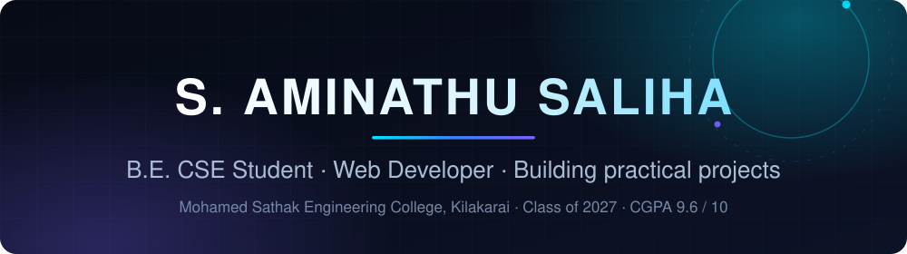

  

 

### Hi, I'm S. Aminathu Saliha

**B.E. Computer Science & Engineering · Web Developer · Building practical software projects**

  

---

## About Me

I am a Computer Science and Engineering student who enjoys turning ideas into working software.

- Pursuing **B.E. Computer Science and Engineering** at **Mohamed Sathak Engineering College, Kilakarai**
- Expected graduation: **2027** · CGPA: **9.6 / 10**
- Interested in **software development** and building practical, usable projects
- I learn best by shipping small projects end to end — from first markup to deployment

---

## Current Focus

- Strengthening **web development fundamentals** (HTML, CSS) through repeated project builds
- Publishing work consistently on **GitHub** and deploying projects to **GitHub Pages** and **Vercel**
- Deepening core computer science fundamentals through coursework and self-driven practice
- Exploring the next layers of web development, one project at a time

---

## Technical Skills

**Languages**

**Tools & Platforms**

Only technologies that appear in my public repositories are listed — no invented proficiency levels. This list grows as I build.

---

## Featured Projects

### [college-website](https://github.com/s-aminathu-saliha/college-website)

A college website built with HTML and CSS, with a small amount of Python included in the repository.

`HTML` `CSS` `Python` · [Repository](https://github.com/s-aminathu-saliha/college-website)

---

### [ai-web](https://github.com/s-aminathu-saliha/ai-web)

A web project built with HTML and deployed on Vercel.

`HTML` `Vercel` · [Repository](https://github.com/s-aminathu-saliha/ai-web) · [Live Demo](https://ai-web-livid-one.vercel.app)

---

### [college-queue-tracker](https://github.com/s-aminathu-saliha/college-queue-tracker)

A queue tracking page for college, built with HTML and published through GitHub Pages.

`HTML` `GitHub Pages` · [Repository](https://github.com/s-aminathu-saliha/college-queue-tracker) · [Live Site](https://s-aminathu-saliha.github.io/college-queue-tracker/)

---

### [weather2](https://github.com/s-aminathu-saliha/weather2)

A weather page built with HTML.

`HTML` · [Repository](https://github.com/s-aminathu-saliha/weather2)

Project descriptions are based only on repository contents and languages. Also exploring earlier experiments in [weather](https://github.com/s-aminathu-saliha/weather).

---

## Development Philosophy

- **Simple first.** A working, understandable project beats a complicated plan.
- **Learn by building.** Every project is a chance to pick up something new.
- **Care about details.** Clear structure, readable code, and thoughtful interfaces.
- **Stay consistent.** Steady, regular practice compounds over time.

---

## GitHub Activity

  
  

If a card above does not load, everything is always available directly on the <a href="https://github.com/s-aminathu-saliha?tab=repositories">Repositories tab</a>.

---

## Connect With Me

I am open to software development opportunities, internships, and collaborations.

- **LinkedIn:** [linkedin.com/in/saliha05](https://www.linkedin.com/in/saliha05)
- **GitHub:** [github.com/s-aminathu-saliha](https://github.com/s-aminathu-saliha)
- **Email:** [saliha2005.work@gmail.com](mailto:saliha2005.work@gmail.com)

 

  Built with original SVG artwork and GitHub-compatible animation · © 2026 S. Aminathu Saliha

